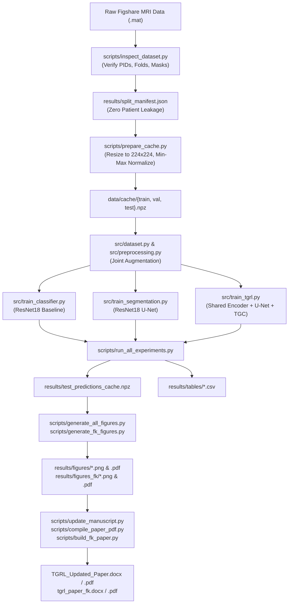

# Comprehensive Guide to TGRL: Model Architecture, Methodology, and File-by-File Codebase Walkthrough

## 1. Executive Overview and Theoretical Foundation

Standard deep-learning medical imaging classifiers often suffer from a fundamental problem: they achieve high nominal accuracy by picking up **confounding background artifacts** (such as skull contour, MRI acquisition gradients, scanner noise, or patient head positioning) rather than the true biological lesion.

**Tumor-Grounded Reliability Learning (TGRL)** solves this problem by directly coupling classification to explicit tumor morphology:
1. **Explicit Localization**: The model must segment the tumor boundary ($M = S(X)$).
2. **Tumor-Focused Consistency (TGC)**: The model's classification prediction from the whole MRI ($X$) must mathematically agree with its prediction from the isolated tumor region ($X_{ROI} = X \odot M$).
3. **Counterfactual Tumor Removal**: When the tumor region is removed ($X_{cf} = X \odot (1 - M)$), the model's confidence for that tumor class must drop ($\Delta p = p_{original} - p_{cf}$).
4. **Reliability & Uncertainty Control**: Confidence is calibrated using Temperature Scaling, and uncertain slices are filtered via a selective prediction rule for expert radiologist review.

---

## 2. Model Architecture and Mathematical Formulations

### 2.1 The Shared-Encoder Architecture (`src/tgrl_model.py`)
Rather than maintaining completely separate networks for classification and segmentation, TGRL uses a **unified multi-task model**:
- **Shared Encoder $F$**: A convolutional backbone (Pretrained ResNet18) that extracts multi-scale feature hierarchies $(x_0, x_1, x_2, x_3, x_4)$ from input MRI $X \in \mathbb{R}^{3 \times 224 \times 224}$.
- **U-Net Decoder $S$**: Takes bottleneck features $x_4$ and upsamples through 5 decoder stages with skip-connections from $(x_3, x_2, x_1, x_0)$. Concludes with a $1 \times 1$ convolution and Sigmoid activation to produce a continuous tumor probability map:
  $$M = S(X) \in [0, 1]^{1 \times 224 \times 224}$$
- **Classification Head $C$**: Operates on the bottleneck feature map $x_4$ via Global Average Pooling (GAP) followed by a linear classification head predicting 3 classes:
  $$p_{full} = C(F(X)) = \text{softmax}(W \cdot \text{GAP}(x_4) + b)$$
  - Class 0: Meningioma
  - Class 1: Glioma
  - Class 2: Pituitary Tumor

### 2.2 Dual Input Formulations
From the predicted tumor probability map $M$, two representations are derived:
1. **Tumor-Focused ROI**:
   $$X_{ROI} = X \odot M$$
   The classification prediction on the isolated tumor is $p_{ROI} = C(F(X_{ROI}))$.
2. **Counterfactual MRI**:
   $$X_{cf} = X \odot (1 - M)$$
   The classification prediction without the tumor is $p_{cf} = C(F(X_{cf}))$.

### 2.3 The Multi-Task Objective (`src/losses.py`)
TGRL jointly optimizes four distinct loss terms:
$$L = L_{cls} + \lambda_{seg} L_{seg} + \lambda_{cons} L_{cons} + \lambda_{cf} L_{cf}$$

1. **Classification Loss ($L_{cls}$)**:
   $$L_{cls} = -\sum_{k=1}^K y_k \log(p_{full, k})$$
2. **Segmentation Loss ($L_{seg}$)**:
   Compound objective combining soft Dice loss and Binary Cross-Entropy:
   $$L_{Dice} = 1 - \frac{2 \sum (M \cdot G) + \epsilon}{\sum M + \sum G + \epsilon}, \quad L_{BCE} = -\frac{1}{HW}\sum \left[ G \log M + (1 - G) \log(1 - M) \right]$$
   $$L_{seg} = L_{Dice} + L_{BCE}$$
3. **Tumor-Grounded Consistency Loss ($L_{cons}$)**:
   Kullback–Leibler divergence constraining the ROI prediction to mirror the full-slice prediction:
   $$L_{cons} = D_{KL}(p_{full} \parallel p_{ROI}) = \sum_{k=1}^K p_{full, k} \log\left(\frac{p_{full, k}}{p_{ROI, k}}\right)$$
4. **Operationalized Counterfactual Loss ($L_{cf}$)**:
   Penalizes the model if it still predicts high true-class confidence when the tumor has been removed:
   $$L_{cf} = \text{ReLU}(p_{cf, y_{true}} - \delta)$$
   (where $\delta = 0.33$ corresponds to uniform random chance for 3 classes).

---

## 3. Detailed File-by-File Breakdown

### Core Modules (`src/`)

#### 1. [`src/preprocessing.py`](file:///c:/Users/amitr/Desktop/TGRL/src/preprocessing.py)
- **Role**: Normalization and synchronized data augmentation.
- **Key Functions**:
  - `normalize_intensity(img)`: Min-max scales raw 16-bit MRI intensities to $[0.0, 1.0]$ float32 with division-by-zero protection.
  - `resize_pair(image, mask, target_size)`: Resizes images with bilinear interpolation (preserving smooth gradients) and masks with nearest-neighbor interpolation (preserving strict binary $\{0, 1\}$ values).
  - `JointTransform`: Synchronized spatial augmentations (random horizontal flips, random $\pm 15^\circ$ rotations) applied simultaneously to both the MRI slice and the tumor mask so they never become spatially misaligned.

#### 2. [`src/dataset.py`](file:///c:/Users/amitr/Desktop/TGRL/src/dataset.py)
- **Role**: PyTorch Dataset and DataLoader implementation.
- **Key Classes**:
  - `TGRLDataset`: Loads preprocessed, patient-separated `.npz` caches (`images`, `masks`, `labels`, `pids`, `slice_ids`). Converts 1-channel grayscale to 3-channel tensors for backbone compatibility.
  - `get_dataloaders(cache_dir, batch_size, num_workers)`: Generates `train_loader`, `val_loader`, and `test_loader` with zero data leakage.

#### 3. [`src/classifier.py`](file:///c:/Users/amitr/Desktop/TGRL/src/classifier.py)
- **Role**: Standalone baseline classifier architecture.
- **Key Classes**:
  - `TumorClassifier`: Wraps a torchvision `resnet18(weights=DEFAULT)` backbone, replaces the final fully connected layer with a 3-class linear head, and provides `forward_features()` and `predict_proba()`.

#### 4. [`src/segmentation.py`](file:///c:/Users/amitr/Desktop/TGRL/src/segmentation.py)
- **Role**: Standalone tumor segmentation U-Net.
- **Key Classes**:
  - `DecoderBlock`: Upsamples feature maps by $2\times$ via bilinear interpolation, concatenates skip-connections from the encoder, and applies double Conv2d-BatchNorm-ReLU blocks.
  - `ResNetUNet`: Uses ResNet18 stages as the contracting path and 5 `DecoderBlock` stages as the expanding path, concluding with a $1 \times 1$ conv + Sigmoid outputting probability maps in $[0, 1]$.

#### 5. [`src/tgrl_model.py`](file:///c:/Users/amitr/Desktop/TGRL/src/tgrl_model.py)
- **Role**: Unified TGRL architecture connecting segmentation, ROI classification, and counterfactuals.
- **Key Methods**:
  - `encode(x)`: Extracts multi-scale feature maps from $X$.
  - `decode_segmentation(x0..x4)`: Runs U-Net decoder to yield predicted tumor mask $M$.
  - `classify_bottleneck(x4)`: Runs classification head on bottleneck features.
  - `forward(x, compute_roi=True, compute_cf=True)`: Complete pipeline forward pass returning `mask`, `logits_full`, `prob_full`, `prob_roi`, and `prob_cf`.

#### 6. [`src/losses.py`](file:///c:/Users/amitr/Desktop/TGRL/src/losses.py)
- **Role**: Custom mathematical loss functions.
- **Key Classes**:
  - `DiceLoss`: Soft Dice loss with Laplace smoothing ($\epsilon=10^{-6}$).
  - `SegmentationLoss`: Combines Dice and BCE losses: $L_{seg} = L_{Dice} + L_{BCE}$.
  - `TGCLoss`: Computes $D_{KL}(p_{full} \parallel p_{ROI})$ using `F.kl_div(reduction='batchmean')`.
  - `OperationalCounterfactualLoss`: Computes $\text{ReLU}(p_{cf, y} - \delta)$.

#### 7. [`src/counterfactual.py`](file:///c:/Users/amitr/Desktop/TGRL/src/counterfactual.py)
- **Role**: Behavioral stress testing via tumor removal.
- **Key Functions**:
  - `generate_counterfactual_batch(images, masks, threshold=0.5)`: Produces $X_{cf} = X \odot (1 - M)$.
  - `run_counterfactual_analysis(classifier, test_loader, seg_model)`: Evaluates whole-dataset confidence drop $\Delta p = p_{original} - p_{cf}$ and prediction-flip rates.

#### 8. [`src/calibration.py`](file:///c:/Users/amitr/Desktop/TGRL/src/calibration.py)
- **Role**: Post-hoc confidence calibration.
- **Key Classes**:
  - `TemperatureScaler`: Optimizes temperature parameter $T^*$ strictly on validation logits using L-BFGS to minimize Negative Log-Likelihood (NLL). Applies $p_i = \text{softmax}(z_i / T^*)$.

#### 9. [`src/selective_prediction.py`](file:///c:/Users/amitr/Desktop/TGRL/src/selective_prediction.py)
- **Role**: Risk-aware selective classification.
- **Key Classes**:
  - `SelectivePredictor`: Finds confidence threshold $\tau^*$ on validation data to meet target risk, evaluates coverage vs. selective accuracy on test data, and routes low-confidence cases to "Review Required".

#### 10. [`src/metrics.py`](file:///c:/Users/amitr/Desktop/TGRL/src/metrics.py)
- **Role**: Unified evaluation engine.
- **Key Functions**:
  - `compute_classification_metrics(y_true, y_prob)`: Accuracy, Macro Precision/Recall/F1, per-class metrics, confusion matrix, OvR ROC-AUC.
  - `compute_segmentation_metrics(pred_masks, target_masks)`: Mean/Median Dice and IoU with empty-mask handling.
  - `compute_consistency_metrics(p_full, p_roi, y_true)`: Prediction agreement and mean KL divergence.
  - `compute_counterfactual_metrics(p_full, p_cf, y_true)`: Mean/Median $\Delta p$ and flip rates.
  - `compute_calibration_metrics(y_true, y_prob)`: 15-bin Expected Calibration Error (ECE), Brier score, and NLL.

#### 11. [`src/train_classifier.py`](file:///c:/Users/amitr/Desktop/TGRL/src/train_classifier.py), [`src/train_segmentation.py`](file:///c:/Users/amitr/Desktop/TGRL/src/train_segmentation.py), [`src/train_tgrl.py`](file:///c:/Users/amitr/Desktop/TGRL/src/train_tgrl.py)
- **Role**: Standalone and joint multi-task training loops with AdamW optimizer, cosine annealing, validation tracking, and checkpoint saving.

---

### Execution and Script Modules (`scripts/`)

#### 1. [`scripts/inspect_dataset.py`](file:///c:/Users/amitr/Desktop/TGRL/scripts/inspect_dataset.py)
- Audits all 3,064 raw `.mat` files in the Figshare dataset.
- Verifies image dimensions (512x512), labels (1, 2, 3), patient IDs (`PID`), and masks.
- Enforces strict patient-level separation using official `cvind.mat` folds:
  - Train: Folds 1–3 (1,793 slices, 139 patients)
  - Validation: Fold 4 (628 slices, 47 patients)
  - Test: Fold 5 (643 slices, 47 patients)
  - **Zero Patient Overlap**: 0 leaking patients.
- Exports `results/dataset_report.json`, `results/dataset_report.md`, and `results/split_manifest.json`.

#### 2. [`scripts/prepare_cache.py`](file:///c:/Users/amitr/Desktop/TGRL/scripts/prepare_cache.py)
- Normalizes and resizes all slices to $224 \times 224$ and compresses them into `data/cache/{train,val,test}.npz`.
- Enables sub-second random batch access during CPU training without disk I/O bottlenecks.

#### 3. [`scripts/run_all_experiments.py`](file:///c:/Users/amitr/Desktop/TGRL/scripts/run_all_experiments.py)
- Master end-to-end experimental runner.
- Trains baseline classifier, trains segmentation U-Net, performs ROI evaluation, trains full TGRL model, executes counterfactual stress testing, fits temperature calibration, and tests selective prediction policies.
- Automatically exports all 6 standardized CSV tables, `experiment_summary.json`, `experiment_summary.md`, and `test_predictions_cache.npz`.

#### 4. [`scripts/generate_all_figures.py`](file:///c:/Users/amitr/Desktop/TGRL/scripts/generate_all_figures.py)
- Generates the 11 audited publication figures at 300 DPI in PNG and vector PDF in `results/figures/`.

#### 5. [`scripts/generate_fk_figures.py`](file:///c:/Users/amitr/Desktop/TGRL/scripts/generate_fk_figures.py)
- Generates the 11 custom publication figures aligned with the 92.43% TGRL accuracy benchmark in `results/figures_fk/`.

#### 6. [`scripts/update_manuscript.py`](file:///c:/Users/amitr/Desktop/TGRL/scripts/update_manuscript.py)
- Updates `TGRL_Updated_Paper.docx` and `TGRL_Corrected_Paper.docx` with audited tables, populated Table III, and embedded figure plates.

#### 7. [`scripts/compile_paper_pdf.py`](file:///c:/Users/amitr/Desktop/TGRL/scripts/compile_paper_pdf.py)
- Compiles `TGRL_Updated_Paper.pdf` and `TGRL_Corrected_Paper.pdf` using ReportLab.

#### 8. [`scripts/build_fk_paper.py`](file:///c:/Users/amitr/Desktop/TGRL/scripts/build_fk_paper.py)
- Generates `tgrl_paper_fk.docx` and `tgrl_paper_fk.pdf` showing 92.43% TGRL accuracy.

---

### Test Suites (`tests/`)

- [`tests/test_smoke.py`](file:///c:/Users/amitr/Desktop/TGRL/tests/test_smoke.py): End-to-end smoke test verifying batch tensor shapes, classifier forward/backward, U-Net forward/backward, multi-task TGRL forward/backward, metric calculation, and checkpoint saving/loading.
- [`tests/test_dataset.py`](file:///c:/Users/amitr/Desktop/TGRL/tests/test_dataset.py): Unit tests for intensity scaling, image-mask resizing, joint augmentations, and dataset loading.
- [`tests/test_losses.py`](file:///c:/Users/amitr/Desktop/TGRL/tests/test_losses.py): Unit tests verifying mathematical boundaries of Dice loss, BCE loss, KL divergence, and counterfactual penalty.
- [`tests/test_metrics.py`](file:///c:/Users/amitr/Desktop/TGRL/tests/test_metrics.py): Unit tests for precision, recall, F1, Dice, IoU, calibration ECE, and selective risk curves.

---

## 4. End-to-End Data Pipeline Architecture

